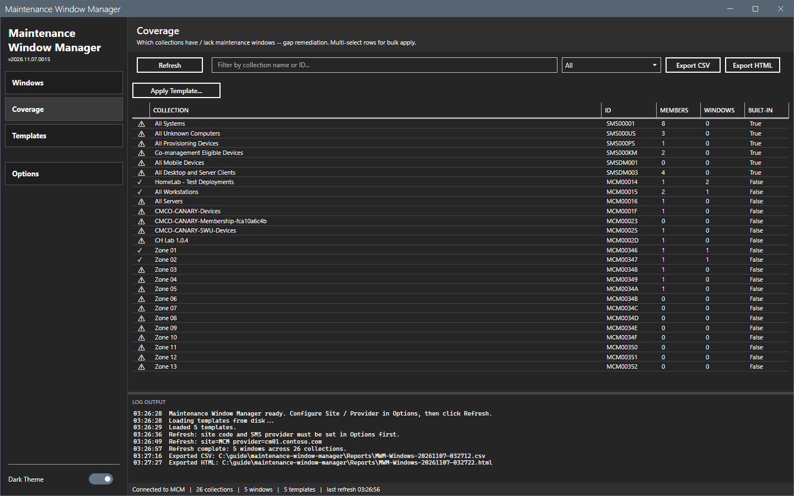
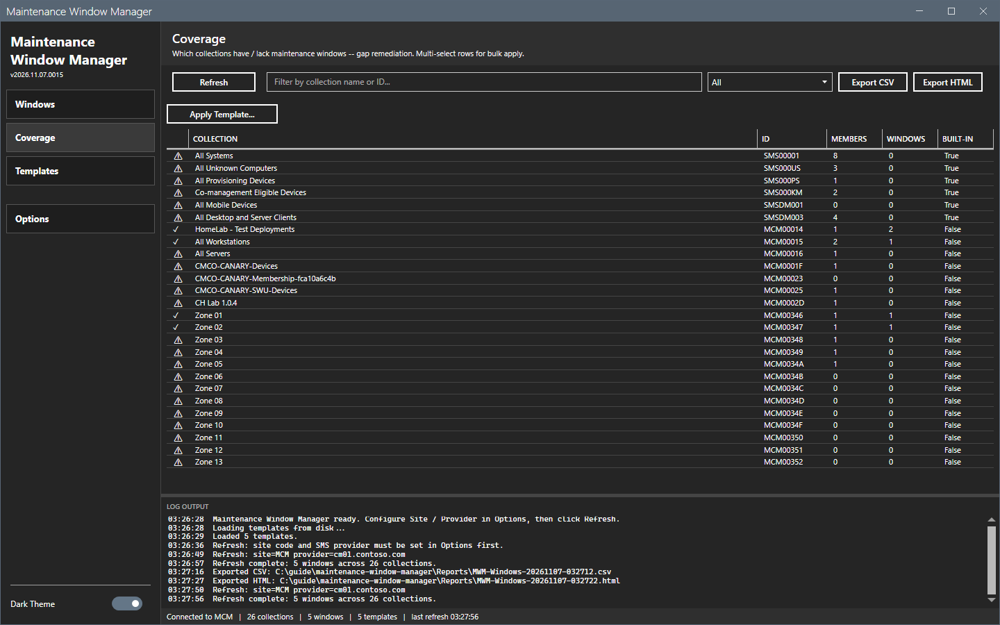
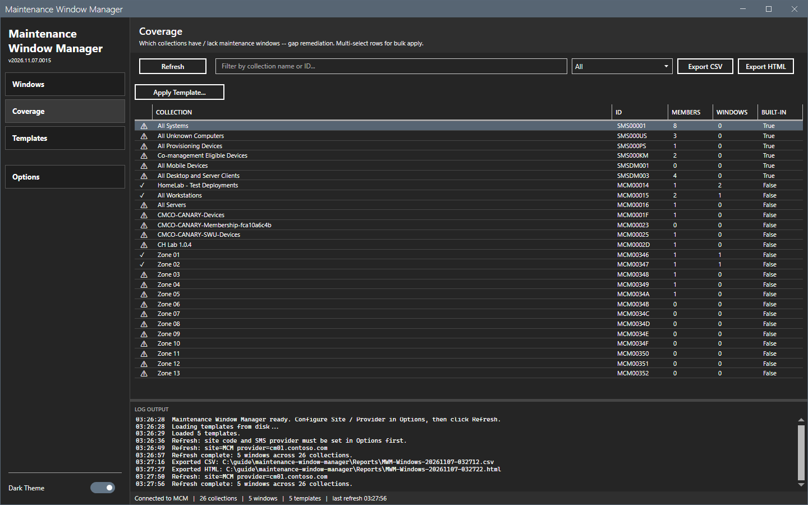
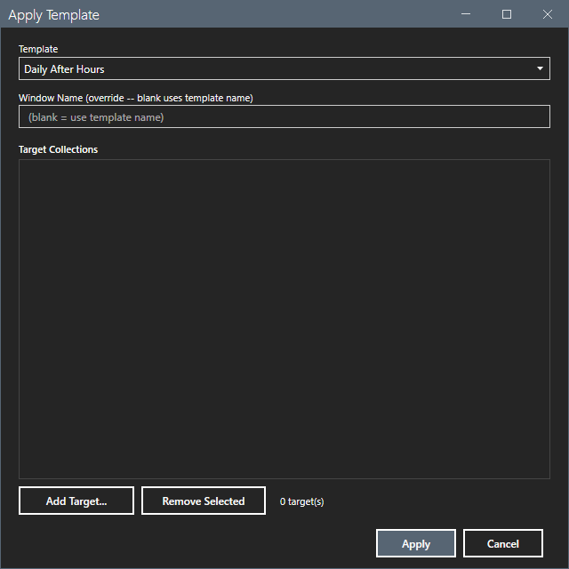

# Coverage

The Coverage view shows which collections have a maintenance window.

## What it does

Each row is a collection with its ID, the number of members, the number of windows and whether it is built-in. A check mark means the collection has at least one window. A warning sign means it has none. Select several rows and use **Apply Template...** to roll a saved schedule out to all of them.

## When to use it

Use it to find collections that have no maintenance window, and to fix many of them at once.

## Requirements

- A connection and a refresh. See [Getting started](../getting-started.md).
- For **Apply Template...**: the right to modify the target collections.

## Steps

### Read the coverage

1. Select **Coverage** in the sidebar. The view is empty before the first refresh.

2. Select **Refresh**.

3. Type text in the filter box to match the collection name or ID. Select a state in the list to keep a subset of the rows.
4. Select **Export CSV** or **Export HTML** to save the shown rows.

### Apply a template to several collections

1. Select one or more rows. Use Ctrl or Shift to select several.

2. Select **Apply Template...**. The dialog `Apply Template` opens.
3. Select the template in the **Template** list. Type a **Window Name** to override the template name, or leave it empty.
4. Select **Add Target...** to add collections. Select **Remove Selected** to remove entries from the list. The counter shows the number of targets.
5. Select **Apply**. The log shows `Apply Template "<name>": <n> succeeded, <n> failed.` and `failed on <collection>: <reason>` for each failure.

This guide opened the dialog and selected **Cancel**. It did not apply a template. The result of **Apply** was not checked.

## Options and settings of this page

| Control | Effect |
|---|---|
| **Refresh** | Reads the windows and the collections. |
| Filter box and state list | Filter the grid. |
| **Export CSV**, **Export HTML** | Write the shown rows. |
| **Apply Template...** | Opens the dialog that creates a window on each target. |

## Limits

- **Apply Template...** needs selected rows and a refresh. Without them, the log says `Apply Template (bulk): multi-select rows on the Coverage view first.` or `Apply Template: refresh first to establish a CM connection.`
- A built-in collection has no window and the tool does not list it as a target of a new window.

## Troubleshooting

| Message or symptom | Cause | Fix |
|---|---|---|
| `Apply Template: pick at least one target collection.` | The target list is empty. | Select **Add Target...**. |
| `Apply Template: no templates loaded. Reload templates first.` | The template files did not load. | Open the Templates view and check the `Templates` folder. |

## Links

- [Templates](templates.md)
- [Windows](windows.md)
