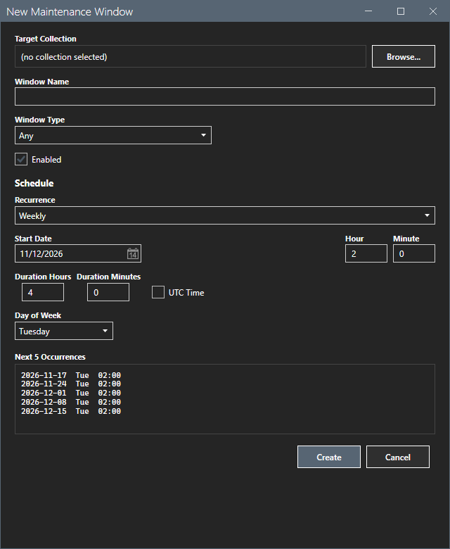

# Schedule editor

The schedule editor is part of the New Window, Edit Window and Template dialogs.

## What it does

It sets when a maintenance window starts and how long it lasts. The **Next 5 Occurrences** box shows the next five start times for the settings that you chose. The box updates when you change a setting.

## When to use it

Use it in each dialog that creates or changes a schedule.

## Requirements

- The New Window and Edit Window dialogs need a connection to the site and a successful refresh before they open.
- The Template editor opens without a connection.

## Steps

### Choose the recurrence

Select a value in **Recurrence**:

| Recurrence | Settings |
|---|---|
| **One-time** | A date and a time. |
| **Daily** | A start date and a time. The window repeats every day. |
| **Weekly** | The **Day of Week**. |
| **MonthlyByDate** | The **Day of Month**, 1 to 31. |
| **MonthlyByWeekday** | The **Week Order** (First, Second, Third, Fourth or Last) and the **Day of Week**. |
| **PatchTuesday** | An offset in days after the second Tuesday of each month. |

The settings that do not belong to the recurrence are hidden.

### Set the start and the duration

1. Select the **Start Date** and type the **Hour** and the **Minute**.
2. Type the **Duration Hours** and the **Duration Minutes**.
3. Select **UTC Time** if the times are UTC.

### Read the preview

The **Next 5 Occurrences** box shows the dates and times, for example `2026-11-10  Tue  02:00`. It skips every date at or before the current time. If today is 10 November, the start date is 20 November and the day of the month is 5, the first line is 5 December. For a weekly schedule, the first line is the first selected weekday on or after the start date. For a monthly schedule, it is the first selected day that is on or after the start date and in the future.

For a one-time schedule with a start date in the past, the box shows a hint that the start date must be in the future.

## Options and settings of this page

| Control | Effect |
|---|---|
| **Recurrence** | Chooses the kind of schedule. |
| **Start Date**, **Hour**, **Minute** | Set the first start. |
| **Duration Hours**, **Duration Minutes** | Set the length of the window. |
| **UTC Time** | Reads the times as UTC. |
| **Day of Week**, **Week Order**, **Day of Month**, offset | Set the day, by recurrence. |

## Limits

- The preview comes from the settings of the editor. The site computes the real schedule.
- A day of the month above the length of a month is cut to the last day of that month. The selected day stays for the other months, so day 31 gives 30 November and 31 December. The day 0 means the last day.
- The week order Last gives the last selected weekday of each month.

## Troubleshooting

| Message or symptom | Cause | Fix |
|---|---|---|
| The preview shows `no future occurrences`. | A one-time start is in the past, or the recurrence is not set. | Set a start date in the future. |

## Links

- [Windows](windows.md)
- [Templates](templates.md)
