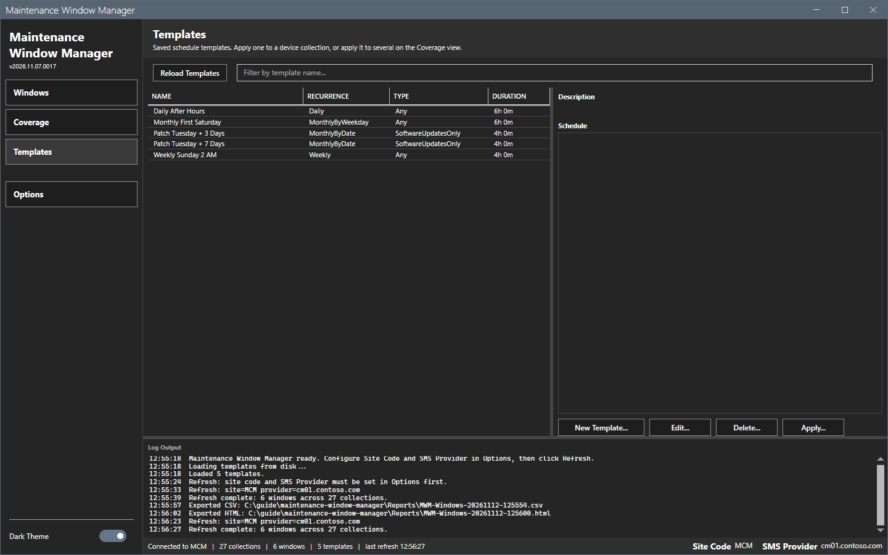
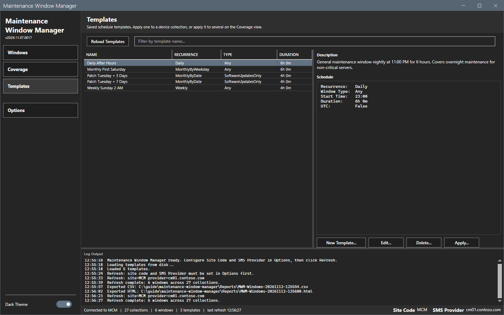
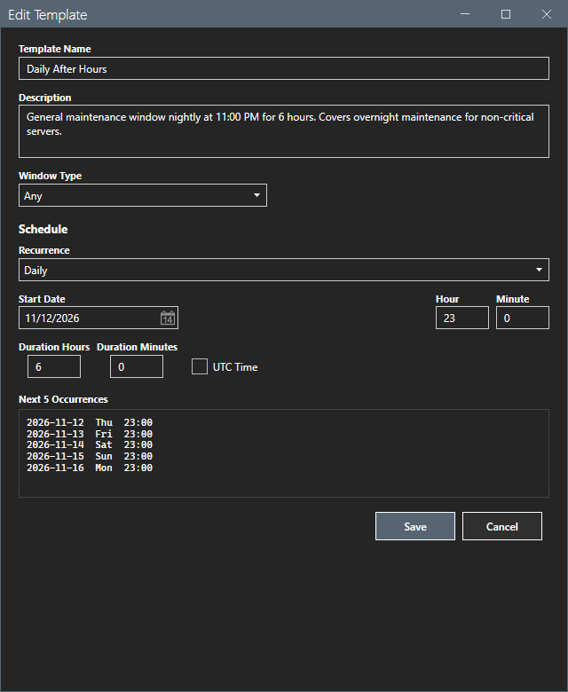
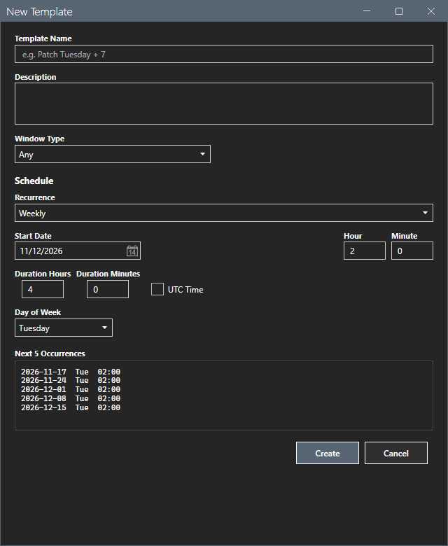
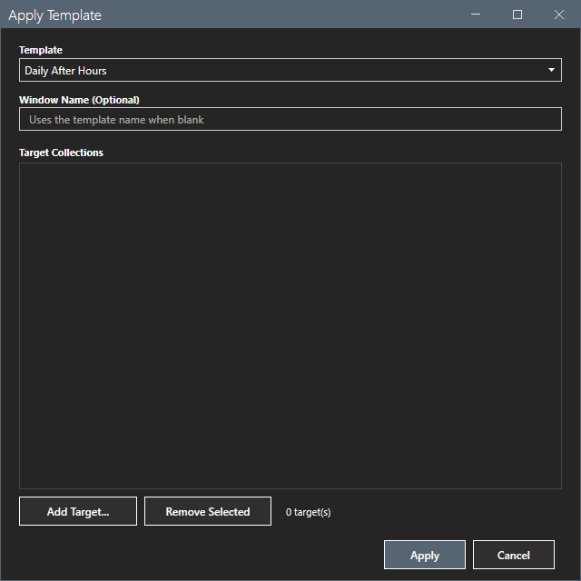

# Templates

The Templates view holds saved schedules that you can apply to collections.

## What it does

The tool ships five baseline templates: Daily After Hours, Monthly First Saturday, Patch Tuesday + 3 Days, Patch Tuesday + 7 Days and Weekly Sunday 2 AM. Each template is a JSON file in `Templates` with a name, a description, a window type and a schedule. You can edit them and make your own.

## When to use it

Use it to keep tested schedules in one place and to apply them to one or many collections.

## Requirements

- No connection to read the templates.
- For **Apply Template...**: a refresh and the right to modify the collection.

## Steps

### Read a template

1. Select **Templates** in the sidebar.

2. Select a row. The description and the schedule summary show below the grid.

### Edit a template

1. Select a template and select **Edit...**. The dialog `Edit Template` shows the name, the description, the window type and the schedule.

2. Change the values. See [Schedule editor](schedule-editor.md).
3. Select **Save**. The log shows `Template saved: <name> (<file>)`. If you change the name, the tool removes the old file.

### Create a template

1. Select **New Template...**.

2. Type the name, the description, the window type and the schedule. Select **Create**. The template becomes a JSON file in `Templates`.

### Delete a template

Select a template and select **Delete...**. A confirmation asks first. The log shows `Deleted template: <name>`.

### Apply a template to one collection

1. Select a template and select **Apply...**.

2. Pick the collection, confirm the window name and select **Apply**.

This guide opened the New, Edit and Apply dialogs and selected **Cancel**. It did not save, delete or apply a template.

## Options and settings of this page

| Control | Effect |
|---|---|
| **Reload Templates** | Reads the template files again. |
| **New Template...**, **Edit...**, **Delete...** | Change the template files. |
| **Apply...** | Creates a window from the selected template on one collection. |

## Limits

- The templates are files in `Templates`. Edits survive a restart.
- A template needs a name. Without one, the log says `Template: name required.`

## Troubleshooting

| Message or symptom | Cause | Fix |
|---|---|---|
| `Template load failed. The log file has the details.` | A template file is damaged. | Open the log file. Restore or delete the file and restart the tool. |
| `Edit Template: pick a template first.` and `Delete Template: pick a template first.` | No row is selected. | Select a template. |

## Links

- [Coverage](coverage.md)
- [Schedule editor](schedule-editor.md)
