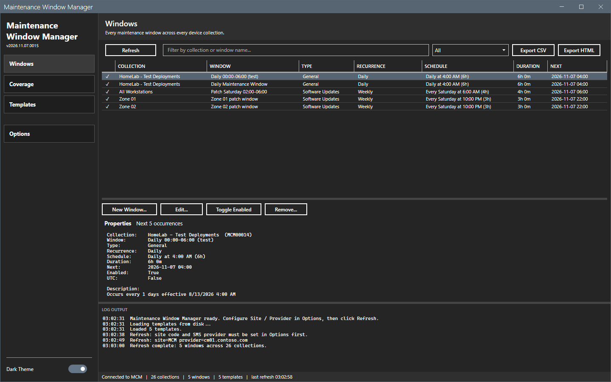
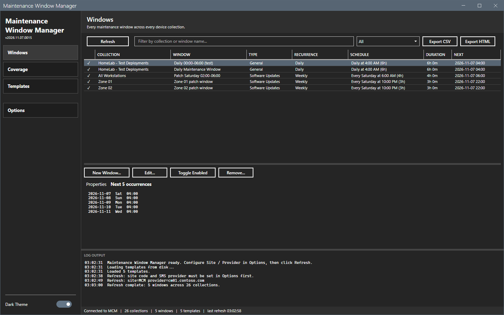
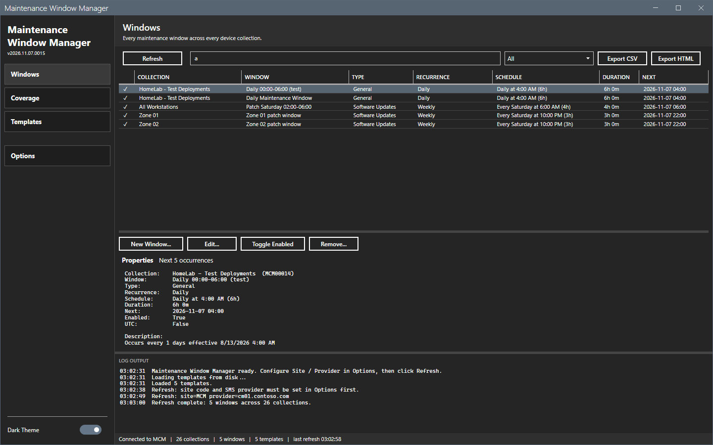
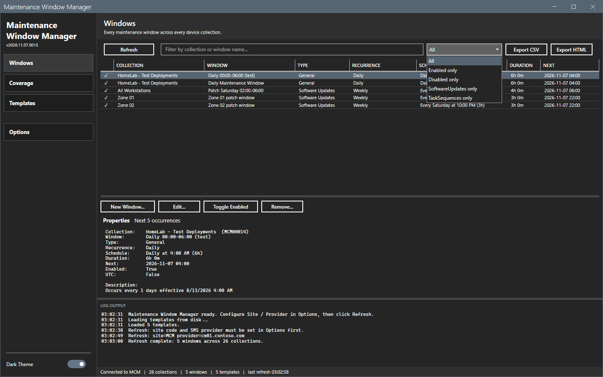
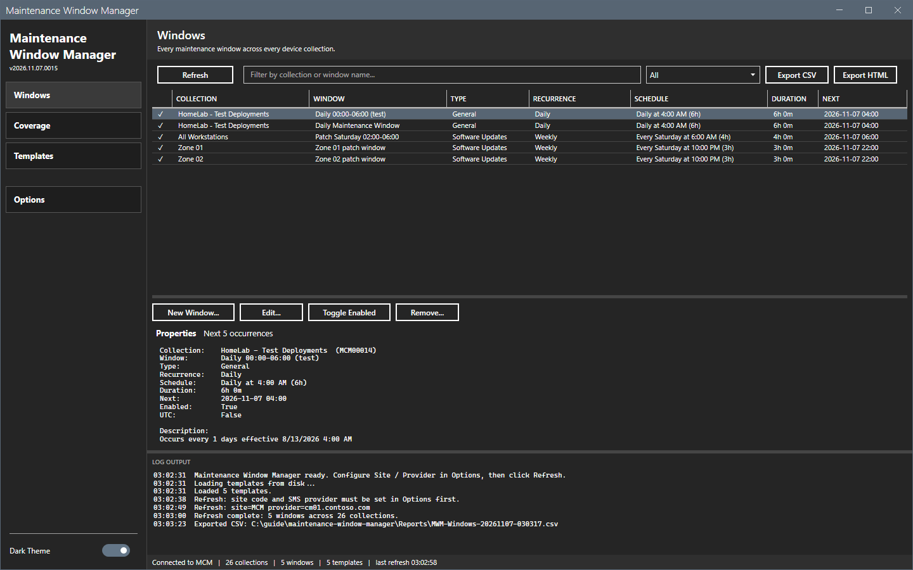
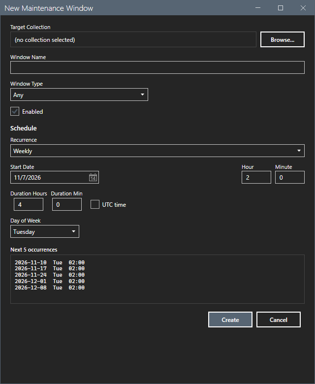
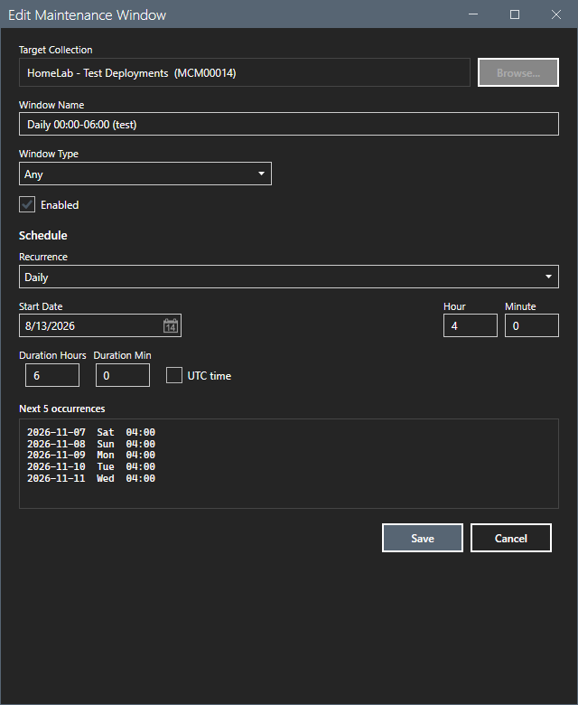

# Windows

The Windows view lists every maintenance window of every device collection.

## What it does

Each row shows a status glyph (a check mark for an enabled window, a dotted mark for a disabled one), the collection, the window name, the type, the recurrence, the schedule in words, the duration and the next occurrence. The tabs below the grid show the properties of the selected window and its next five occurrences. The buttons create, change, enable, disable and remove windows.

## When to use it

Use it to read the maintenance windows of the site and to change them.

## Requirements

- A connection and a refresh. See [Getting started](../getting-started.md).
- For the buttons: the right to modify the collection.

## Steps

### Read the windows

1. Select **Windows** in the sidebar and select **Refresh**.
2. Select a row. The **Properties** tab shows the window.

3. Select the **Next 5 occurrences** tab. It shows the next five start times of the window.

### Filter the view

1. Type text in the filter box. The grid matches the collection and the window name.
2. Select a status in the list: **All**, **Enabled**, **Disabled**, **SoftwareUpdates** or **TaskSequences**.

### Export the view

1. Select **Export CSV** or **Export HTML**.
2. In the Save As dialog, keep the name or type a new name. The folder is `Reports` beside the script. The name is `MWM-Windows-<date>-<time>`.
3. Select **Save**. The log shows `Exported CSV:` and the path.

### Create a window

1. Select **New Window...**. The dialog `New Maintenance Window` opens.
2. Select **Browse...** and pick the target collection in the folder tree. Built-in collections are not in the list.
3. Type the window name. Select the window type: **Any**, **SoftwareUpdatesOnly** or **TaskSequencesOnly**. Set **Enabled**.
4. Set the schedule. See [Schedule editor](schedule-editor.md). The preview shows the next five occurrences.
5. Select **Create**. The log shows `Created maintenance window "<name>" on <collection>`.

### Change a window

1. Select a row and select **Edit...**. The dialog shows the window.

2. Change the name, the type, the enabled flag or the schedule, and select **Save**. If you change the name, the tool deletes the window and creates it again, because the site keys a window by its name. A change without a new name uses a plain update. If the new window cannot be created after the old window was deleted, the log says so.

### Enable, disable or remove

1. Select a row and select **Toggle Enabled** to switch the window on or off. The log shows `Toggled "<name>" on <collection> -> <state>`.
2. Select **Remove...** to delete the window. A confirmation asks first.

This guide opened the New and Edit dialogs and selected **Cancel**. It did not create, change, toggle or remove a window. The results of those buttons were not checked.

## Options and settings of this page

| Control | Effect |
|---|---|
| **Refresh** | Reads the windows and the collections. |
| Filter box and status list | Filter the grid. |
| **Export CSV**, **Export HTML** | Write the shown rows. |
| **New Window...**, **Edit...**, **Toggle Enabled**, **Remove...** | Change the site. |

## Limits

- The three buttons that act on a window need a selected row. Without one, the log says `<action>: pick a window first.`
- Every button that changes the site needs a refresh first.
- A rename deletes and recreates the window. For a short time the collection has no such window.

## Troubleshooting

| Message or symptom | Cause | Fix |
|---|---|---|
| `Validation: target collection required.` | No collection is selected. | Select **Browse...** and pick a collection. |
| `Validation: window name required.` | The name is empty. | Type a name. |
| `Rename aborted: failed to remove the old window.` | The site refused the delete. | Read the log. The old window stays. |
| `Rename failed: old window deleted but new one did not create. Check log.` | The new window was refused. | Create the window again with the schedule. |

## Links

- [Schedule editor](schedule-editor.md)
- [Coverage](coverage.md)
