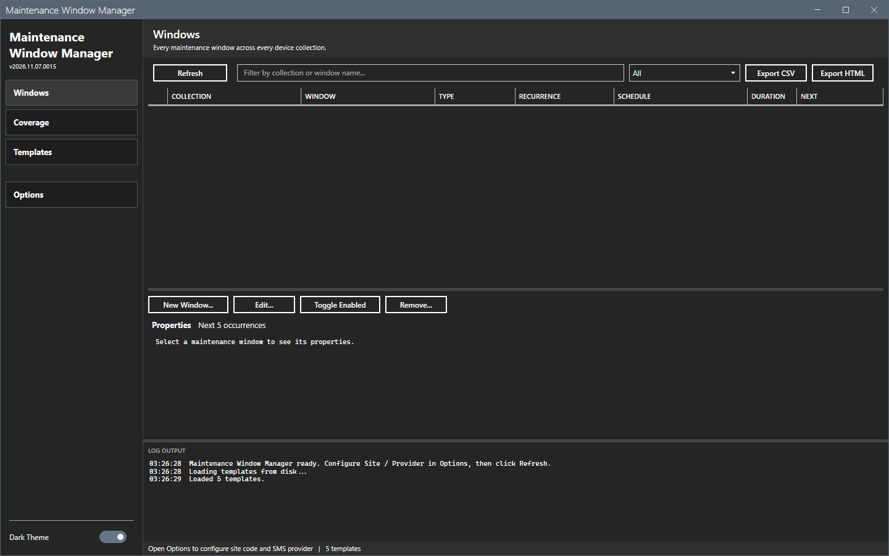
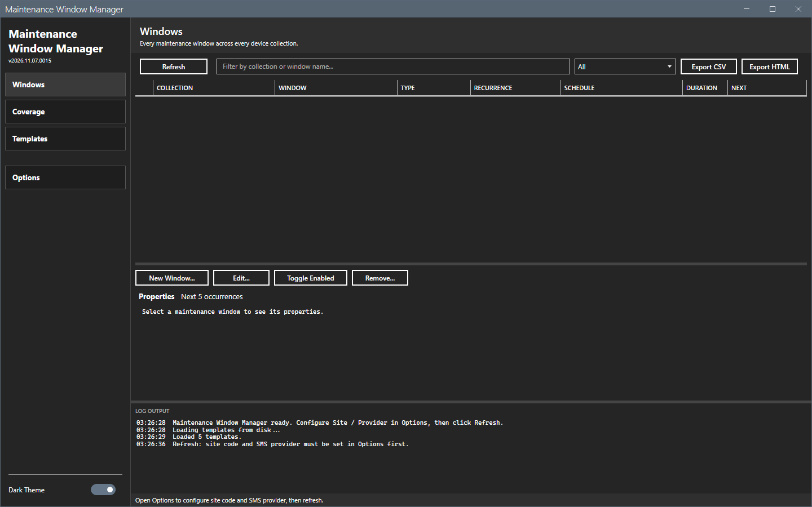
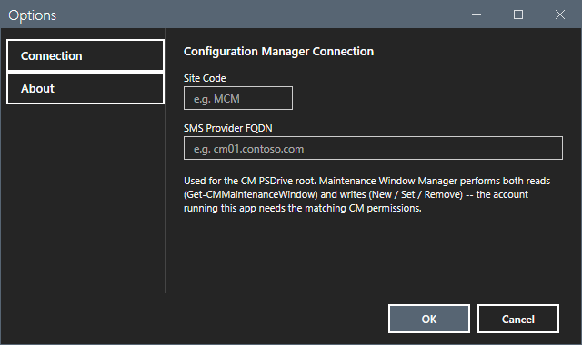
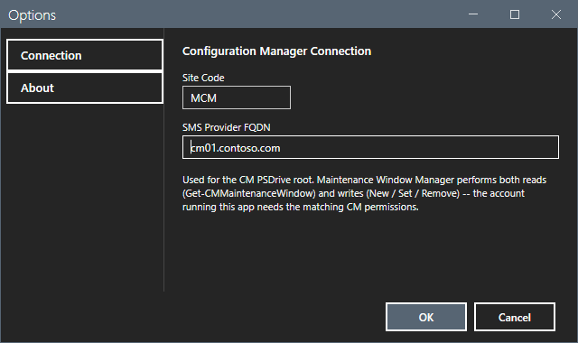
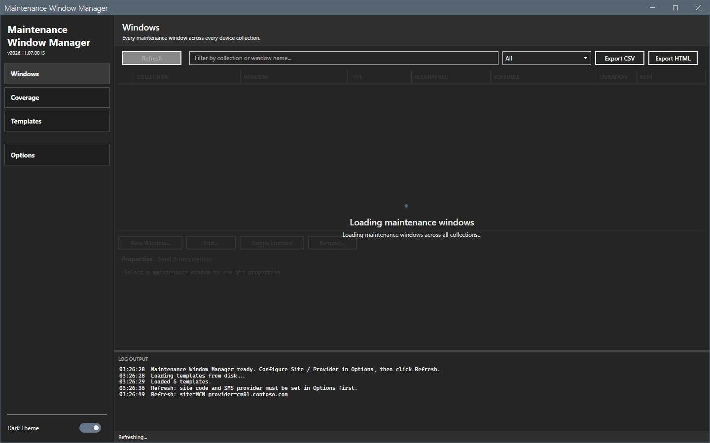
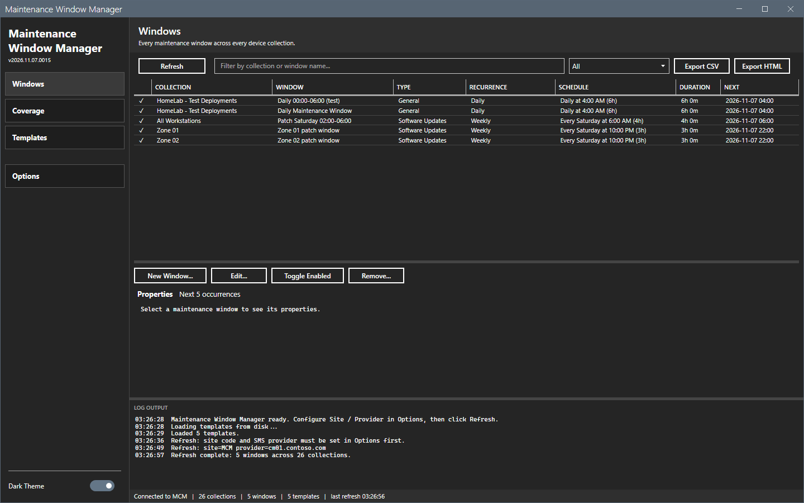

# Getting started

This page shows how to start Maintenance Window Manager, set the connection and load the windows.

## What it does

The tool reads the maintenance windows of all device collections of a Configuration Manager site through its SMS Provider. It shows each window with a readable schedule and its next occurrence. It creates, changes, enables, disables and removes windows. It also shows which collections have no window and rolls a saved schedule out to many collections.

## When to use it

Use it to review the maintenance windows of a site, to find collections without a window, and to create windows from tested schedules.

## Requirements

- Windows 10, Windows 11 or Windows Server 2016 or later, PowerShell 5.1 and .NET Framework 4.7.2 or later.
- The Configuration Manager console. The tool loads the `ConfigurationManager` PowerShell module of the console. Without the console, **Refresh** fails with a message in the log. See [Error messages](reference/error-messages.md).
- Rights on the site to read collections and, for the buttons that change a window, to modify collections. See [Permissions](reference/permissions.md).

## Steps

### Start the tool

1. Extract the release zip to a folder that you can write to. The tool saves its settings, logs, templates and reports in that folder.
2. Right-click `start-maintenancewindowmgr.ps1` and select **Run with PowerShell**. Or run this command:

```powershell
powershell -ExecutionPolicy Bypass -File start-maintenancewindowmgr.ps1
```

The window opens on the **Windows** view. The window of the first start is empty. The five baseline templates load from disk at the start.



If you select **Refresh** before you set the connection, the log asks you to open Options.



### Set the connection

1. Select **Options** in the sidebar.
2. Type the **Site Code**, for example `MCM`.
3. Type the **SMS Provider FQDN**, for example `cm01.contoso.com`.
4. Select **OK**.





### Load the windows

1. Select **Refresh**. A progress overlay shows.
2. Wait for the log to show `Refresh complete: <n> windows across <n> collections.`





## Options and settings of this page

None. The settings are on [Options dialog](core/options.md).

## Limits

- Every view that reads the site needs a refresh first.
- The window opens on the view that was open when you closed it.

## Troubleshooting

| Message or symptom | Cause | Fix |
|---|---|---|
| The log shows `Refresh: site code and SMS provider must be set in Options first.` | The site code or the provider is empty. | Set the connection. |
| The log shows `Refresh failed: Failed to connect to site <code> (provider <name>).` | The console is not installed on this computer, or the provider name is wrong, or `SMS_ADMIN_UI_PATH` does not point to the `bin\i386` folder of the console. | Check the provider name. Install the console. If it is installed, set `SMS_ADMIN_UI_PATH` to its `bin\i386` folder and start the tool again. |

## Links

- [Windows](core/windows.md)
- [Options dialog](core/options.md)
- [Troubleshooting](troubleshooting.md)
