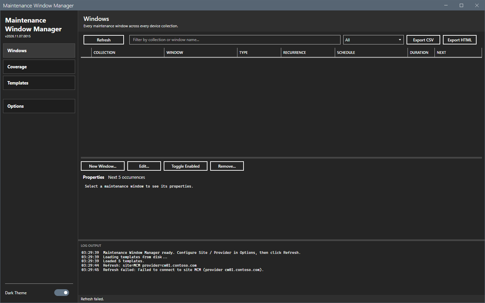

# Error messages

This page lists the messages of Maintenance Window Manager with cause and fix. The messages show in the log pane and in the status bar.

## What it does

It maps a message to its cause and to a fix.

## When to use it

Use it when a refresh or a change does not work.

## Requirements

None.

## Messages

| Message | Where | Cause | Fix |
|---|---|---|---|
| `Refresh: site code and SMS provider must be set in Options first.` | Log | The site code or the provider is empty. | Set both in **Options > Connection**. |
| `Refresh failed: Failed to connect to site <code> (provider <name>).` | Log | The console is not installed on this computer, or the provider name is wrong or not reachable, or `SMS_ADMIN_UI_PATH` does not point to the `bin\i386` folder of the console. | Check the provider name. Install the console. If it is installed, set `SMS_ADMIN_UI_PATH` to its `bin\i386` folder and start the tool again. |
| `<action>: refresh first to establish a CM connection.` | Log | No refresh has run. | Select **Refresh**. |
| `Edit: pick a window first.`, `Toggle: pick a window first.`, `Remove: pick a window first.` | Log | No row is selected. | Select a row. |
| `Validation: target collection required.` and `Validation: window name required.` | Log | A field of the dialog is empty. | Fill the field. |
| `Create returned null -- check log for details.` and `Schedule creation returned null.` | Log | The site refused the window or the schedule. | Read the log lines before. |
| `The window was not updated -- check the log for details. The dialog stays open.` | Dialog | The site refused the change. | Read the log. Correct the values. |
| `Rename aborted: failed to remove the old window.` | Log | The delete of the old window failed. The old window stays. | Read the log. |
| `Rename failed: old window deleted but new one did not create. Check log.` | Log | The new window was refused after the delete. | Create the window again. |
| `Apply Template: pick at least one target collection.` | Log | The target list is empty. | Add a target. |
| `Apply Template: no templates loaded. Reload templates first.` | Log | No template file loaded. | Check the `Templates` folder and select **Reload Templates**. |
| `Template: name required.` | Log | The template has no name. | Type a name. |
| `Template load failed: <reason>` and `Save Template failed: <reason>` | Log | A template file cannot be read or written. | Read the reason. Check the folder. |
| `Export CSV: nothing to export.` and `Export HTML: nothing to export.` | Log | The grid has no rows. | Select **Refresh** or clear the filter. |

The image shows **Refresh** on a computer without the console. The window stays open, the grid stays empty and the log names the cause.

If the window closes without a message, read the crash log `Logs\MWM-crash-<date>-<time>.txt` and the startup transcript in `Logs`.

## Steps

1. Find the message in the table.
2. Do the fix.
3. Run the action again.

## Limits

- The messages are in English.

## Troubleshooting

See [Troubleshooting](../troubleshooting.md).

## Links

- [Troubleshooting](../troubleshooting.md)
- [Permissions](permissions.md)
